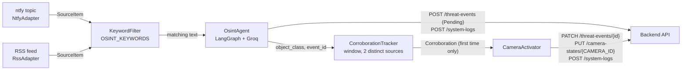

# OSINT pipeline

The OSINT module (`ai-brain/`) is a host program and an HTTP client of the backend API. It never imports `backend/` code or touches the database. The entrypoint is `ai-brain/main.py`, which runs one of two paths depending on `FEATURE_LIVE_OSINT` (`ai-brain/osint_settings.py`):

- **Mock path** (flag off, the default): classify the alerts in `mock_alerts.json` once and exit. No corroboration, no camera change.
- **Live path** (flag on): poll the ntfy and RSS adapters until interrupted, classify matching items, and set the camera Active when two distinct sources agree.

`OsintIngestionApp` loads `ai-brain/.env` with `python-dotenv` before anything else. `load_dotenv` does not override variables already set in the process environment.

## Data flow

### Live path

1. **Startup** (`main.py`, `_run_live`). `HeimdallAPIClient.authenticate` posts `OSINT_API_USERNAME` and `OSINT_API_PASSWORD` to `POST /auth/login` and keeps the bearer token on its HTTP session (`ai-brain/osint_client.py`). `OsintAgent` is then built, which requires `GROQ_API_KEY`. `configure_logging` turns on INFO logging if nothing else has configured it.
2. **Source registration** (`LiveOsintRunner.register_sources`, `ai-brain/live_osint.py`). The runner calls `GET /sources`, reuses the `source_id` of any adapter whose `source_name` is already stored, and calls `POST /sources` only for missing names. It prints the chosen id for each adapter.
3. **Poll cycle** (`_run_cycle`). Every adapter is polled once, in order (ntfy first, then RSS). Then the runner sleeps `OSINT_POLL_SECONDS` and repeats.
4. **Deduplication** (`SourceAdapter.poll`, `ai-brain/source_adapter.py`). Each adapter remembers the external ids it has already yielded and skips them. Items with an empty external id are dropped. This memory lasts only for the life of the process.
5. **Keyword filter** (`KeywordFilter.keep`, `ai-brain/keyword_filter.py`). A case-insensitive substring match against `OSINT_KEYWORDS`. Items that do not match are logged at INFO (`Dropped OSINT item <id> from <source>: no keyword match.`) and never reach Groq.
6. **Classification** (`OsintAgent.run`, `ai-brain/osint_agent.py`). A three-node LangGraph: `ingest_alert` trims the text, `classify_with_llm` asks Groq model `openai/gpt-oss-20b` (temperature 0) for `object_class` and `confidence_score` as structured output (with a plain-JSON fallback parser), and `post_to_api` creates a threat event (`source_id`, `object_class`, `confidence_score`, status `Pending`) and a system log with module `osint-agent`. `object_class` is trimmed and lowercased.
7. **Corroboration** (`CorroborationTracker.observe`, `ai-brain/corroboration.py`). Only results with no error, a non-empty `object_class`, and a positive `threat_event.event_id` are observed. The tracker keys on the lowercased `object_class`, drops sightings older than `CORROBORATION_WINDOW_SECONDS` relative to the new report, and fires when two or more distinct `source_id`s remain for that class. The same source reporting twice never counts. Timestamps come from the source item (ntfy `time`, RSS `pubDate`), not from when the item was processed. A class fires at most once per process unless an activation fails (see Failure behavior).
8. **Activation** (`CameraActivator.activate`, `ai-brain/camera_activation.py`). In this order: `PATCH /threat-events/{event_id}` with status `Corroborated` and `corroborated_at` (UTC ISO-8601) for every event in the window, `PUT /camera-states/{CAMERA_ID}` with mode `Active`, fps `5`, resolution `720p`, then one `POST /system-logs` naming the class and source ids, attached to the first event. The camera row must already exist; the activator does not create it.

### Mock path

`main.py` reads `mock_sources.json` and `mock_alerts.json`, authenticates, registers each mock source with `POST /sources` (a `409 Conflict` is treated as already registered and the existing record is looked up), maps each alert's `source_name` to its `source_id`, builds `OsintAgent`, runs every alert through it, and prints a per-alert summary. It does not poll, filter by keyword, corroborate, or touch any camera.

## Source adapters

Both adapters subclass `SourceAdapter` (`ai-brain/source_adapter.py`). An adapter provides `registration_payload()` (the `POST /sources` body) and `_fetch_items()` (one fetch of the current page). The base class `poll()` handles deduplication. Each item is a `SourceItem` with `source_name`, `text`, `timestamp`, and `external_id`.

| Adapter | `source_name` | `source_type` | Registered `url` | Reliability |
|---|---|---|---|---|
| `NtfyAdapter` | `ntfy-tipline` | `Public Push` | `<NTFY_SERVER>/<NTFY_TOPIC>` | 0.5 |
| `RssAdapter` | `local-rss-feed` | `RSS` | `RSS_FEED_URL` | 0.5 |

### ntfy (`ai-brain/ntfy_adapter.py`)

- One plain HTTP GET per poll to `<server>/<topic>/json?poll=1&since=<since>`. It does not open the ntfy streaming connection. No credentials are sent.
- `since` is `10m` on the first poll, then the id of the last message seen, so later polls only ask for newer messages.
- The response is JSON lines. Only objects with `event` equal to `message`, an `id`, and a non-empty `message` become items. Open and keepalive events, blank lines, and lines that are not JSON objects are skipped.
- `timestamp` is the unix `time` field in UTC, or the current time when it is missing.
- An empty `NTFY_TOPIC` raises `ValueError("NTFY_TOPIC is not set.")`. A blank `NTFY_SERVER` falls back to `https://ntfy.sh`.

### RSS (`ai-brain/rss_adapter.py`)

- One HTTP GET per poll to `RSS_FEED_URL`, parsed with the standard-library `xml.etree.ElementTree`. Tags match with or without an XML namespace.
- Each `<item>` under `<channel>` needs a `guid` (the external id) and some text. Text is the `title` and `description` joined with a newline.
- `timestamp` is the RFC 822 `pubDate` (naive dates are treated as UTC), or the current time when it is missing or unparsable.
- A blank `RSS_FEED_URL` falls back to `http://localhost:8001/feed.xml`.

### Local demo feed (`ai-brain/demo_feed.py`)

`python ai-brain/demo_feed.py` starts a standard-library HTTP server on `127.0.0.1`. `GET /` is a form, `POST /items` stores a report in memory (request body capped at 8192 bytes), and `GET /feed.xml` serves the reports as RSS 2.0 with guids `demo-1`, `demo-2`, and so on. This is what the default `RSS_FEED_URL` points at.

The port comes from `DEMO_FEED_PORT` (default `8001`, also used when the value is not a valid port). That variable is read only by the demo server and is not listed in `ai-brain/.env.example`, so it is not in the table below.

## Environment variables

These are exactly the variables in `ai-brain/.env.example`, in the same order. "Example value" is the value in that file. "Default in code" is what the code uses when the variable is unset.

| Variable | Example value | Default in code | Used by | Purpose |
|---|---|---|---|---|
| `GROQ_API_KEY` | *(empty)* | none; required | Both paths (`osint_agent.py`) | Groq API key for classification. Missing or blank stops startup. |
| `BASE_URL` | `http://localhost:8000` | `http://localhost:8000` | Both paths (`osint_client.py`) | Backend API origin. A trailing `/` is stripped. |
| `OSINT_API_USERNAME` | `replace_with_osint_username` | none; required | Both paths (`osint_client.py`) | Service account for `POST /auth/login`. |
| `OSINT_API_PASSWORD` | `replace_with_osint_password` | none; required | Both paths (`osint_client.py`) | Password for that account. |
| `FEATURE_LIVE_OSINT` | `false` | `false` | `main.py` (`osint_settings.py`) | `1`, `true`, `yes`, or `on` (any case) selects the live path. Anything else keeps the mock path. |
| `NTFY_SERVER` | `https://ntfy.sh` | `https://ntfy.sh` | Live path (`ntfy_adapter.py`) | ntfy origin, without the topic. |
| `NTFY_TOPIC` | `heimdall-demo-change-me` | none; required on the live path | Live path (`ntfy_adapter.py`) | Public ntfy topic to poll. |
| `RSS_FEED_URL` | `http://localhost:8001/feed.xml` | `http://localhost:8001/feed.xml` | Live path (`rss_adapter.py`) | RSS 2.0 document to poll. |
| `OSINT_POLL_SECONDS` | `5` | `5` | Live path (`osint_settings.py`) | Seconds to sleep between poll cycles. Positive float. |
| `OSINT_KEYWORDS` | `shots,gun,weapon,armed,fire,explosion,suspicious,fight,robbery,threat` | the same ten words | Live path (`keyword_filter.py`) | Comma-separated keywords. Blank entries are ignored; an empty list uses the defaults. |
| `CORROBORATION_WINDOW_SECONDS` | `300` | `300` | Live path (`osint_settings.py`) | Maximum age gap, in seconds, between reports that can corroborate. Positive integer. |
| `CAMERA_ID` | `1` | `1` | Live path (`osint_settings.py`) | `camera_states.camera_id` set Active on corroboration. Positive integer. |

`OSINT_POLL_SECONDS`, `CORROBORATION_WINDOW_SECONDS`, and `CAMERA_ID` silently fall back to their defaults when the value is blank, not a number, or not positive (`_positive_float` and `_positive_int` in `osint_settings.py`).

## Failure behavior

Errors are printed to stderr as `Error: ...` or `Error preparing OSINT ingestion: ...`. Keyword drops use `logging` at INFO. `HeimdallAPIUnavailableError` (connection failure or timeout) is a subclass of `HeimdallAPIError`, so every handler below that catches `HeimdallAPIError` also covers an unreachable API. HTTP requests to the API and to both sources use a 10 second timeout.

### Startup (exit code 1, nothing is polled)

| Condition | Where it is caught |
|---|---|
| API unreachable during login | `_authenticate_live` / `run` in `main.py` |
| `OSINT_API_USERNAME` or `OSINT_API_PASSWORD` missing, login rejected, or no `access_token` in the response | same |
| `GROQ_API_KEY` missing (`OsintAgentError`) | `_build_live_agent` / `run` in `main.py` |
| `NTFY_TOPIC` empty (`ValueError` while building the default adapters) | `_start_live` in `main.py` |
| `GET /sources` fails or does not return a list, `POST /sources` fails, or a created source has no `source_id` | `_start_live` in `main.py` |
| Mock path only: a mock JSON file is missing, is not a JSON array, or has an alert without `source_name` or `alert_text`, or an alert names an unregistered source | `run` in `main.py` |

### Inside the live loop (the loop keeps running)

| Condition | Behavior |
|---|---|
| An adapter request fails (`requests.RequestException`: connection error, timeout, or non-2xx status via `raise_for_status`) | Error printed, that adapter yields nothing this cycle, the other adapters still run, polling continues (`_new_items`). |
| ntfy returns lines that are not JSON or not message events | Those lines are skipped (`_accept_line`). |
| RSS returns invalid XML or no `<channel>` | No items this cycle, nothing printed (`_parse_feed`). |
| Groq call or output parsing fails | The result carries `Groq classification failed: ...`; nothing is posted and the item does not count toward corroboration. |
| `POST /threat-events` fails | The result carries the error; nothing counts toward corroboration. |
| Threat event stored but `POST /system-logs` fails | The result keeps `threat_event` but also carries an error, so the runner skips corroboration for that event. |
| Activation fails (`PATCH`, `PUT`, or the activation `POST /system-logs`) | Error printed and `CorroborationTracker.release` re-arms the class, so the next matching report can fire again. Calls that already succeeded are not rolled back. A missing camera row fails here with a 404 from the `PUT`. |
| Ctrl+C after source registration | Prints `Stopped live OSINT polling.` and exits 0. |

Only `requests.RequestException` is caught around an adapter poll and only `HeimdallAPIError` around the agent and the activator. Any other exception ends the process.

On restart, adapter dedup memory and corroboration state start empty. The first ntfy poll asks for the last 10 minutes again and the RSS feed is read in full, so items may be classified and posted a second time.

The mock path processes every alert even if some fail. It exits 1 if any alert finished with an error, otherwise 0.

### Test coverage

The successful path is covered in `ai-brain/tests/`: corroboration rules (`test_corroboration.py`), keyword filtering, source registration, single-source no-op, and the activation order and payloads (`test_live_osint.py`), adapter parsing and dedup (`test_adapters.py`), and login and source mapping (`test_osint_integration.py`). These failure cases have no test yet: an adapter request error not stopping the other adapter, activation failure re-arming the class, and a system-log failure skipping corroboration. T03 in `docs/agent/TASKS.md` covers the first.
